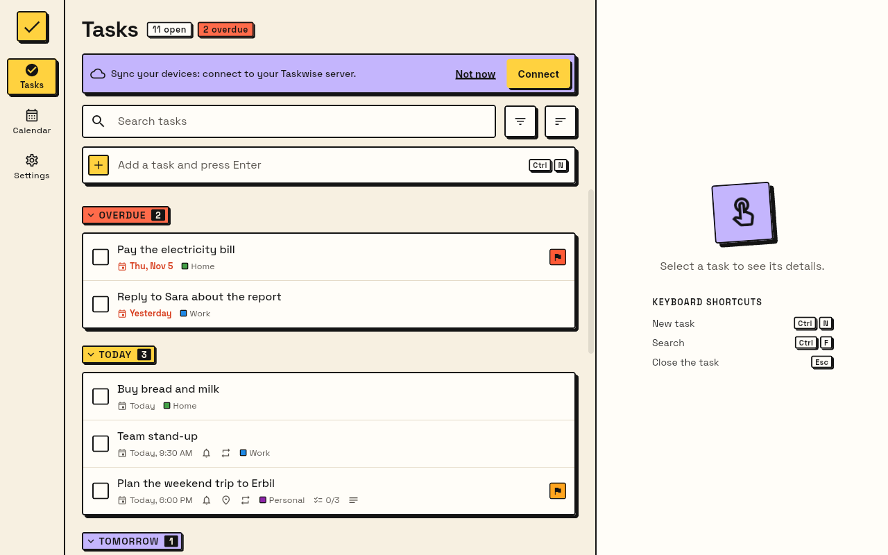
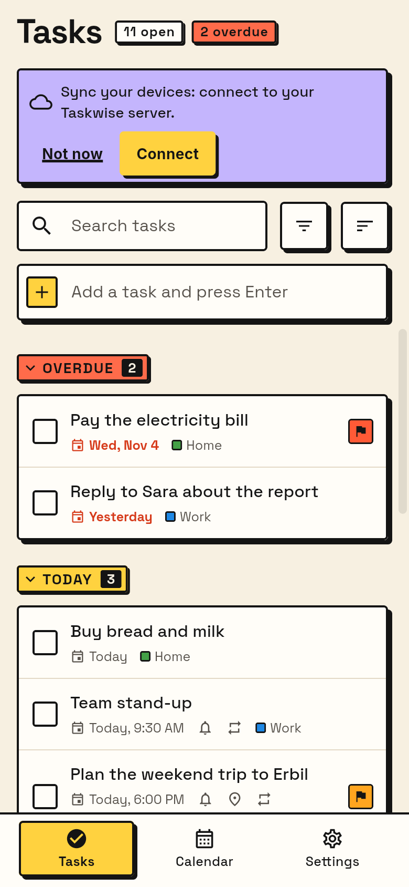
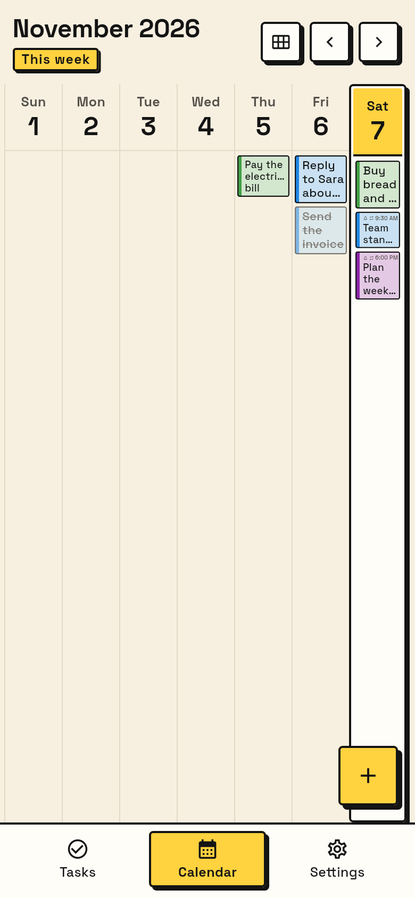
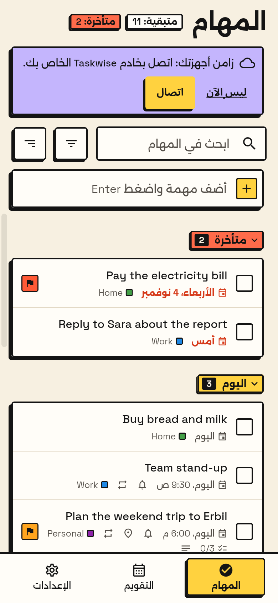
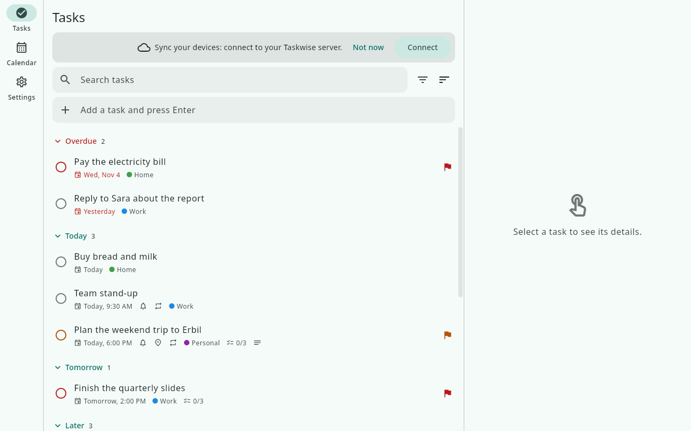
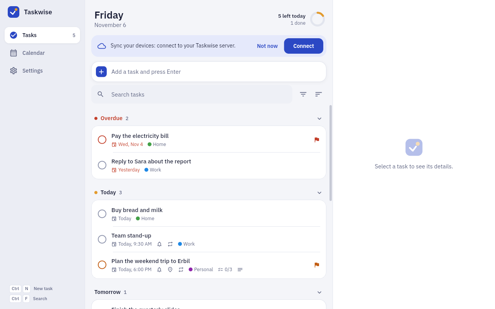
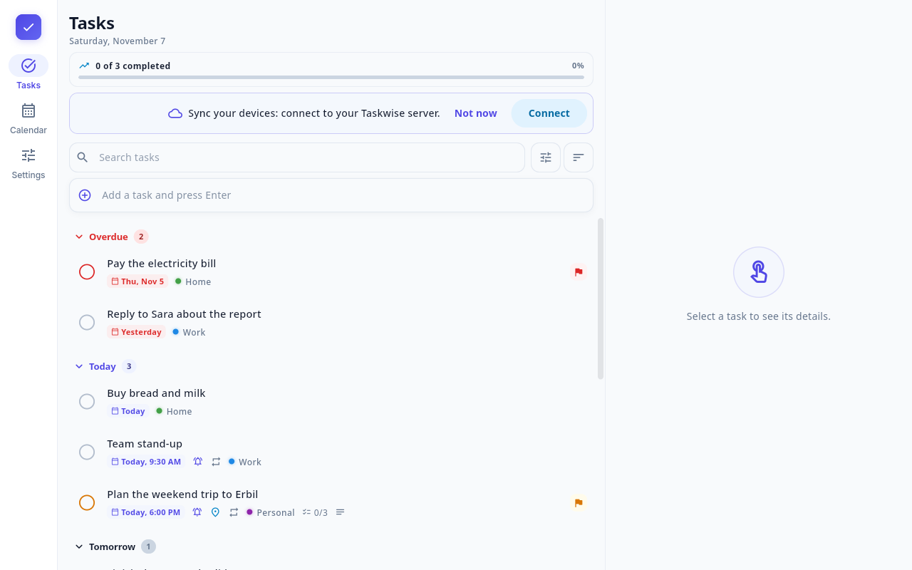

# Taskwise

Taskwise is a personal to-do and reminders app for Windows, Linux and iPhone. It works offline, and it can keep your devices in step through a small sync server that you run yourself, for free. It speaks English and Arabic, and it can remind you by time or, on the iPhone, by place.

<p align="center">
  
</p>

<p align="center">
  
  
  
</p>

## Four designs

Pick a design for each device in **Settings → Appearance → Design**. All of them have a light and a dark look.

| Classic | Lapis |
|---|---|
|  |  |
| **Slate & Indigo** | **Brutal** (the default) |
|  |  |

More screenshots (every screen, light, dark, phone and Arabic) are in [design/](design/README.md).

## Features

- **Tasks** with notes, due date and time, priority, a category (name and colour) and tags.
- **Subtasks:** a checklist inside each task.
- **Repeats:** daily, weekly on chosen days, monthly (a day or "2nd Tuesday"), yearly, every N days/weeks/months, ending never, on a date or after N times.
- **Time reminders:** at a set time or before the due time, as many as you like, with **Done** and **Snooze** buttons on the notification.
- **Location reminders (iPhone only):** pick a place on a map and get a reminder when you arrive or leave. The default radius is 30 m.
- **Calendar:** a week view and a month view.
- **Search, filters and sorting** by category, priority and tag, plus quick add.
- **English and Arabic**, with full right-to-left layout.
- **Light and dark** themes, and **four designs** to choose from.
- **Sync across devices** through your own free server. Each device keeps its own full copy, so the app works offline.
- **JSON backup:** export all your data to a file and import it again (Settings → Backup).
- **Keyboard shortcuts** on desktop (in Lapis and Brutal): `Ctrl+N` new task, `Ctrl+F` search, `Esc` closes the open task. Lapis also has `Ctrl+1`, `Ctrl+2` and `Ctrl+3` for the main tabs.

## Install

Builds for each platform are attached to [GitHub Releases](https://github.com/Krkr8/taskwise/releases). What changed in each version is in the [changelog](CHANGELOG.md).

- [Linux (Fedora)](docs/install-linux.md)
- [Windows 11](docs/install-windows.md)
- [iPhone with SideStore or iloader](docs/install-ios-sidestore.md) (no Mac needed; see also [what works with a free Apple ID](docs/ios-free-apple-id.md))

Taskwise needs no server to work. Add one later if you want your devices to share their tasks.

## Run your own sync server

The sync server is a small TypeScript program ([Hono](https://hono.dev)). You can host it free on Vercel with a Turso database, or run it with Docker or Node.js on your own machine. Nobody else can see your data, and there is nothing to pay for.

See the **[self-hosting guide](docs/self-hosting.md)**.

## Development

Want to change something? Read [CONTRIBUTING.md](CONTRIBUTING.md). The short version:

```bash
gh repo clone Krkr8/taskwise
cd taskwise
flutter pub get                                # fetch dependencies for all packages
(cd app && flutter run -d linux)               # run the app
(cd app && flutter test)                       # app tests
(cd shared && dart test)                       # shared tests
(cd server && npm ci && npm test)              # server tests (Node.js 24)
```

Set up a Fedora machine with [docs/dev-setup-fedora.md](docs/dev-setup-fedora.md) first. `flutter pub get` fetches both Dart packages at once, because `app` and `shared` form a [pub workspace](https://dart.dev/tools/pub/workspaces).

### Where the app keeps its data

The app keeps its SQLite database in the per-user app-support folder, e.g. `~/.local/share/io.github.krkr8.taskwise/taskwise.sqlite` on Linux. Delete that folder to start fresh.

## Repository layout

| Path | What it is |
|---|---|
| `app/` | The Flutter app (Linux, Windows, iOS) |
| `shared/` | Dart models and logic used by the app (repeats, reminder schedule, grouping), plus the sync API fixtures both sides test against |
| `server/` | The sync server: TypeScript + Hono, for Vercel or Docker. See the [sync API](docs/sync-api.md) |
| `design/` | Screenshots of every design |
| `docs/` | Install guides, [self-hosting](docs/self-hosting.md), the [sync API](docs/sync-api.md) and [how the code is organised](docs/architecture.md) |
| `tools/`, `tool/` | The iPhone location simulator, and release packaging scripts |
| `.github/` | CI and release workflows |

## Licence

[MIT](LICENSE)
